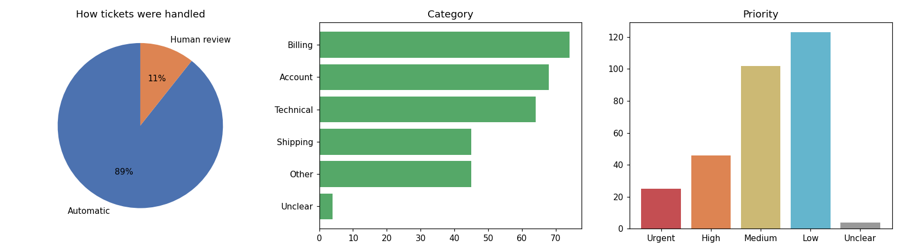
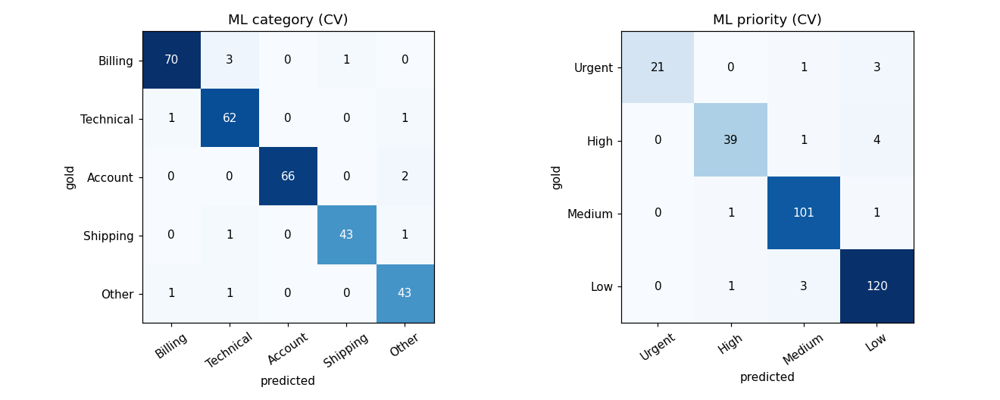

# Triage run report

Processed **300 tickets** in **5.7s** (median 0.3 ms / ticket for the decision step).

## How the tickets were handled

| Outcome | Tickets | Share |
|---|---:|---:|
| Handled automatically | 268 | 89.3% |
| Sent to human review | 32 | 10.7% |

### Automatically handled, by category and priority

| Category | Urgent | High | Medium | Low | Total |
|---|---|---|---|---|---|
| Billing | 9 | 6 | 25 | 24 | 64 |
| Technical | 8 | 8 | 21 | 19 | 56 |
| Account | 3 | 19 | 19 | 25 | 66 |
| Shipping | 0 | 0 | 30 | 10 | 40 |
| Other | 0 | 5 | 0 | 37 | 42 |

### Why tickets went to review

| Reason | Tickets |
|---|---:|
| multiple requests | 14 |
| low confidence | 7 |
| rules vs ML disagree | 5 |
| no usable content | 4 |
| prompt injection | 2 |
| possible under-prioritisation | 2 |

### Urgent tickets (25), page the on-call team

| id | received | category | why | review? |
|---|---|---|---|---|
| T-0008 | 2026-11-16 08:38 | Billing | possible fraud, money is leaving the customer's card right now | no |
| T-0009 | 2026-11-16 08:51 | Technical | outage for a whole business site, many users blocked | yes |
| T-0017 | 2026-11-16 10:07 | Account | account takeover, an attacker may control the customer's devices | no |
| T-0018 | 2026-11-16 10:17 | Billing | possible fraud, money is leaving the customer's card right now | no |
| T-0024 | 2026-11-16 11:08 | Billing | possible fraud, money is leaving the customer's card right now | yes |
| T-0026 | 2026-11-16 11:29 | Billing | possible fraud, money is leaving the customer's card right now | no |
| T-0037 | 2026-11-16 12:35 | Billing | possible fraud, money is leaving the customer's card right now | yes |
| T-0060 | 2026-11-16 15:33 | Billing | possible fraud, money is leaving the customer's card right now | no |
| T-0075 | 2026-11-16 17:10 | Technical | outage for a whole business site, many users blocked | no |
| T-0078 | 2026-11-16 17:39 | Technical | outage for a whole business site, many users blocked | no |
| T-0098 | 2026-11-16 19:56 | Billing | possible fraud, money is leaving the customer's card right now | no |
| T-0102 | 2026-11-16 20:35 | Technical | outage for a whole business site, many users blocked | no |
| T-0125 | 2026-11-16 22:54 | Technical | outage for a whole business site, many users blocked | no |
| T-0135 | 2026-11-17 00:11 | Technical | outage for a whole business site, many users blocked | no |
| T-0138 | 2026-11-17 00:25 | Account | account takeover, an attacker may control the customer's devices | no |
| T-0144 | 2026-11-17 01:14 | Technical | outage for a whole business site, many users blocked | no |
| T-0179 | 2026-11-17 05:23 | Billing | possible fraud, money is leaving the customer's card right now | no |
| T-0235 | 2026-11-17 11:36 | Billing | possible fraud, money is leaving the customer's card right now | yes |
| T-0259 | 2026-11-17 14:14 | Account | account takeover, an attacker may control the customer's devices | no |
| T-0267 | 2026-11-17 15:18 | Technical | outage for a whole business site, many users blocked | no |
| T-0274 | 2026-11-17 16:27 | Technical | outage for a whole business site, many users blocked | no |
| T-0285 | 2026-11-17 17:55 | Billing | possible fraud, money is leaving the customer's card right now | no |
| T-0287 | 2026-11-17 18:16 | Billing | possible fraud, money is leaving the customer's card right now | no |
| T-0297 | 2026-11-17 19:55 | Billing | possible fraud, money is leaving the customer's card right now | no |
| T-0299 | 2026-11-17 20:10 | Billing | possible fraud, money is leaving the customer's card right now | yes |

### Robustness

| Check | Tickets |
|---|---:|
| prompt injections neutralised | 2 |
| log dumps stripped | 5 |
| non-English tickets | 12 |
| tone traps (angry/downplayed) priced by content | 6 |
| ML model unavailable (chaos/real) | 0 |

## Quality against hand-checked labels

| Measure | Value |
|---|---:|
| Category correct on auto-handled tickets | 100.0% |
| Priority correct on auto-handled tickets | 100.0% |
| Both correct on auto-handled tickets | 100.0% |
| Auto-handled tickets given a LOWER priority than they deserve | 0 |
| Urgent tickets caught (labelled Urgent or sent to review) | 100.0% |
| ML alone, 5-fold CV, category accuracy / macro-F1 | 95.9% / 0.96 |
| ML alone, 5-fold CV, priority accuracy / macro-F1 | 94.9% / 0.94 |

_The rules were written from the same reading of the data as the labels, so their score is optimistic; the ML cross-validation numbers are out-of-sample. A real deployment should measure against labels from support agents (see design note)._

## Files

- `results.csv`: id, category, priority, needs_review (the required output)
- `review_queue.csv`: tickets for people, most urgent first, with reasons and suggested labels
- `results_detailed.csv`: every decision with confidence, reasons, notes and explanation
